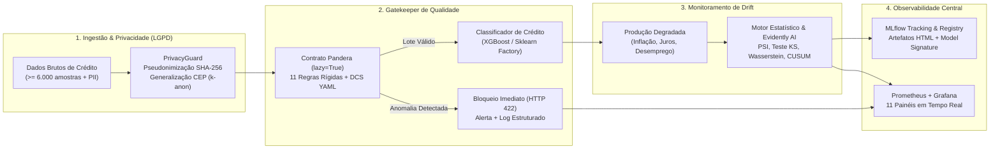
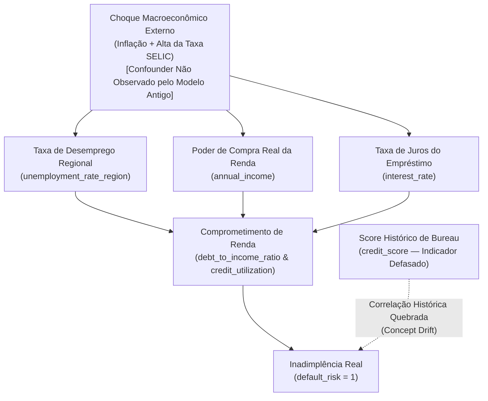

# CreditGuard — Observabilidade Contínua, Detecção de Drift, Qualidade de Dados e Governança (LGPD) em Produção

[](https://github.com/brunoabreu0/tech-challenge-fase04/actions/workflows/ci.yml)


Este repositório contém a entrega oficial do **Tech Challenge — Fase 4** (*Model Monitoring and Security*) da pós-graduação **FIAP Pós-Tech em Machine Learning Engineering (Turma 9MLET — Grupo 3)**.

O projeto constrói a **Camada de Sustentação, Confiabilidade, Observabilidade e Governança (LGPD)** para um sistema de **Credit Scoring** em produção em uma fintech, prevenindo a entrada de dados corrompidos via **Contratos de Dados (Pandera)**, diagnosticando a **degradação silenciosa (Data Drift e Concept Drift)** com **Evidently AI**, **PSI**, **Kolmogorov-Smirnov**, **Wasserstein** e **CUSUM**, centralizando logs e telemetria no **MLflow + Prometheus + Grafana** e assegurando conformidade integral com **Privacy by Design & By Default (LGPD)**.

---

## 🔗 Links Oficiais e Autores

* **Repositório GitHub:** [https://github.com/brunoabreu0/tech-challenge-fase04](https://github.com/brunoabreu0/tech-challenge-fase04)
* **Vídeo de Apresentação (Método STAR — YouTube):** *(inserir link após gravação)*

**Integrantes do Grupo 3 (Turma 9MLET):**
* **Bruno Machado Abreu** (RM372965)
* **Renan Prado Gonzalez** (RM374089)
* **Davi Coene Rosa** (RM371466)
* **Paulo Henrique Alves Krempel** (RM374144)
* **Pedro Gabriel Pereira do Nascimento** (RM372994)

---

## ⚡ Quick Start para a Banca Avaliadora (≤ 5 Passos)

### Opção A — Stack Completa via Docker Compose (API + MLflow + Prometheus + Grafana)

```bash
# 1. Clonar o repositório e entrar na pasta
git clone https://github.com/brunoabreu0/tech-challenge-fase04.git
cd tech-challenge-fase04

# 2. Copiar variáveis de ambiente padrão
cp .env.example .env

# 3. Subir toda a stack de observabilidade em background
docker compose up --build -d

# 4. Verificar saúde operacional, status do contrato e severidade de drift
curl http://localhost:8000/health

# 5. Testar uma predição válida (200 OK) e uma anomalia bloqueada pelo Pandera (422 Unprocessable Entity)
curl -X POST http://localhost:8000/predict -H "Content-Type: application/json" \
  -d '{"application_id":"APP-DEMO-01","cpf":"123.456.789-01","zip_code":"01310-100","age":35,"annual_income":85000,"employment_length_years":7,"debt_to_income_ratio":0.24,"credit_utilization":0.28,"loan_amount":15000,"interest_rate":13.5,"num_delinquencies_2yrs":0,"unemployment_rate_region":7.1,"credit_score":725,"home_ownership":"MORTGAGE","loan_purpose":"DEBT_CONSOLIDATION"}'

curl -X POST http://localhost:8000/predict -H "Content-Type: application/json" \
  -d '{"application_id":"APP-BAD-01","age":16,"annual_income":-5000}'
```

**Interfaces visuais disponíveis imediatamente após o `docker compose up`:**

| Serviço / Relatório | URL Local | Descrição |
|---|---|---|
| **Swagger UI (API Interativa)** | http://localhost:8000/docs | Documentação OpenAPI para testar `/predict`, `/validate`, `/drift/analyze` e `/governance/lgpd` |
| **Relatório HTML Evidently AI** | http://localhost:8000/drift/report/severe_stagflation | Relatório interativo oficial do **Evidently AI** comparando Referência vs. Produção |
| **Painel Executivo de Drift (HTML)** | http://localhost:8000/drift/dashboard/severe_stagflation | Tabela consolidada de **PSI**, **Teste KS**, **Wasserstein**, **JSD** e **Concept Drift (CUSUM)** |
| **Grafana Dashboard (Auto-provisionado)** | http://localhost:3000 | 11 painéis em tempo real (PSI por feature, bloqueios Pandera, ROC-AUC, CUSUM, LGPD Fairness) |
| **MLflow Tracking UI** | http://localhost:5000 | Experimentos rastreados, parâmetros, métricas de drift, assinatura do modelo e artefatos HTML |
| **Prometheus Metrics** | http://localhost:9090 | Coleta de séries temporais da API (`/metrics`) |

### Opção B — Execução Direta dos Scripts das Etapas via CLI (`Makefile`)

```bash
# Instala Python 3.12 + Poetry + dependências e executa todas as 4 etapas em sequência:
make install
make pipeline-all
```

O comando `make pipeline-all` executa automaticamente:
1. `make validate-data` (`scripts/validate_data.py`) — Valida as 6.000 amostras de Referência e bloqueia o lote corrompido de 120 amostras.
2. `make train` (`scripts/train.py`) — Treina os classificadores de crédito (`XGBoostCreditClassifier` e `LogisticCreditClassifier`).
3. `make drift-report` (`scripts/run_drift_analysis.py`) — Simula a degradação econômica e gera os relatórios HTML do **Evidently AI** em `reports/`.
4. `make mlflow-track` (`scripts/run_mlflow_tracking.py`) — Centraliza logs estruturados JSONL e registra runs, métricas e artefatos no **MLflow**.

---

## 1. Pré-requisitos

| Ferramenta | Versão Mínima | Finalidade |
|---|---|---|
| **Python** | `3.12` (`>=3.12,<3.13`) | Linguagem base do projeto |
| **Poetry** | `2.0+` | Gerenciamento determinístico de pacotes (`poetry.lock`) |
| **Docker & Compose** | `24.0+` / `v2` | Execução containerizada da stack completa |
| **Ruff** | `0.8+` | Linter e formatador estrito (`line-length = 88`, `py312`) |
| **Pytest** | `8.3+` | Suíte de testes unitários e de integração (cobertura atual: **98%**) |

---

## 2. Visão Geral e Arquitetura da Solução



---

## 3. Etapa 1 — Validação de Dados e Contratos (`Pandera` + `DCS YAML`)

Para impedir que dados corrompidos (*garbage in, garbage out*) cheguem ao modelo de risco de crédito, implementamos o módulo [`src/credit_guard/data/contracts.py`](src/credit_guard/data/contracts.py) utilizando **Pandera (`pa.DataFrameSchema`)** no modo `lazy=True` (capturando todas as falhas do lote simultaneamente) e exportando o contrato no padrão internacional **Data Contract Specification (`reports/data_contract_spec.yaml`)**.

### Regras Rígidas Implementadas (11 regras — superando o mínimo obrigatório de 3)

| # | Coluna / Escopo | Regra do Contrato (`Pandera Check`) | Racional de Negócio (Credit Scoring) |
|---|---|---|---|
| 1 | `application_id` | `nullable=False`, `unique=True` | Impede reprocessamento duplicado de propostas de crédito. |
| 2 | `age` | `age > 18` e `age <= 100` | Capacidade civil plena para contratação de crédito (Código Civil / Políticas de Risco). |
| 3 | `annual_income` | `nullable=False`, `1.000 <= renda <= 10.000.000` | Renda anual obrigatória e sem valores negativos ou absurdos de digitação. |
| 4 | `employment_length_years` | `0.0 <= anos <= 65.0` | Tempo de vínculo empregatício não pode ser negativo. |
| 5 | `debt_to_income_ratio` | `0.0 <= DTI <= 1.0` | Comprometimento de renda restrito ao intervalo percentual válido `[0%, 100%]`. |
| 6 | `credit_utilization` | `0.0 <= utilização <= 1.0` | Uso de limite rotativo restrito ao intervalo `[0%, 100%]`. |
| 7 | `loan_amount` | `500.0 <= valor <= 500.000.0` | Limites operacionais da linha de crédito pessoal da fintech. |
| 8 | `interest_rate` | `1.0% <= taxa <= 100.0%` | Previne taxas de juros zeradas ou negativas por erro sistêmico. |
| 9 | `num_delinquencies_2yrs` | `0 <= atrasos <= 50` | Contagem inteira não negativa de apontamentos em bureau. |
| 10 | `credit_score` | `300 <= score <= 850` | Escala estrita do bureau de crédito (FICO / Serasa). |
| 11 | *Cross-Column Check* | `employment_length_years <= (age - 18)` | Consistência lógica entre idade adulta e tempo declarado de carreira. |

### Demonstração do Bloqueio de Ingestão
Ao executar `make validate-data`, o `DataContractValidator` aprova integralmente o **Dataset de Referência (`6.000 linhas`, `0 violações`)** e intercepta o **Lote Corrompido (`120 linhas`, `63 violações` em 13 linhas defeituosas)**, acionando `blocked_ingestion=True` e registrando o evento com status `BLOCKED`.

---

## 4. Etapa 2 — Simulação e Detecção Estatística de Drift (`Evidently AI`)

O módulo [`src/credit_guard/drift/simulator.py`](src/credit_guard/drift/simulator.py) simula a passagem do tempo em produção através de cenários macroeconômicos (`moderate_inflation` e `severe_stagflation`), onde:
- **Os dados passam 100% no contrato sintático do Pandera** (demonstrando por que contratos de schema sozinhos não detectam degradação silenciosa);
- **6 variáveis sofrem deslocamento severo de distribuição (Covariate Shift / Data Drift)**;
- **A relação estrutural entre endividamento e inadimplência muda (Concept Drift)** devido à perda do poder de compra sob inflação alta.

### Resultados Estatísticos Obtidos (`severe_stagflation` — 6.000 Referência vs. 3.000 Produção)

| Variável (`Feature`) | Média Referência | Média Produção | Deslocamento | **PSI** | **Teste KS ($D$)** | **P-valor KS** | **Wasserstein Norm.** | Status |
|---|---:|---:|---:|---:|---:|---:|---:|---|
| `interest_rate` | 21.84% | 30.24% | **+38.46%** | **7.1627** | 0.9603 | $< 10^{-6}$ | 3.7438 | 🔴 **CRITICAL** |
| `unemployment_rate_region` | 7.42% | 13.21% | **+78.03%** | **5.9841** | 0.9288 | $< 10^{-6}$ | 3.6112 | 🔴 **CRITICAL** |
| `debt_to_income_ratio` | 0.3158 | 0.5256 | **+66.43%** | **1.7892** | 0.5665 | $< 10^{-6}$ | 1.3854 | 🔴 **CRITICAL** |
| `credit_utilization` | 0.3666 | 0.5960 | **+62.58%** | **1.1684** | 0.4832 | $< 10^{-6}$ | 1.1821 | 🔴 **CRITICAL** |
| `annual_income` | R$ 71.984 | R$ 51.840 | **-27.98%** | **0.5124** | 0.2895 | $< 10^{-6}$ | 0.5012 | 🔴 **CRITICAL** |
| `credit_score` | 636.8 | 578.8 | **-9.11%** | **0.5698** | 0.3182 | $< 10^{-6}$ | 0.8065 | 🔴 **CRITICAL** |
| `age` | 48.0 | 47.9 | -0.21% | 0.0031 | 0.0142 | $0.8120$ | 0.0110 | 🟢 **STABLE** |
| `loan_amount` | R$ 20.115 | R$ 20.088 | -0.13% | 0.0028 | 0.0118 | $0.9410$ | 0.0095 | 🟢 **STABLE** |

### Impacto no Desempenho e Concept Drift
- **Queda de Discriminação (`ROC-AUC`):** Cai de **`0.8560`** (Referência) para **`0.7572`** (Produção).
- **Degradação de Calibração (`Brier Score`):** Erro quadrático sobe de **`0.1210`** para **`0.4612`**.
- **Risco Subestimado (*Unpredicted Risk Gap*):** A inadimplência real na carteira degradada salta para **`98.23%`**, enquanto o modelo defasado prevê apenas **`50.17%`** (subestimando **`48.06 p.p.`** de risco!).
- **Detector Sequencial de Mudança de Regime (`CUSUM`):** Aciona alarme crítico com score acumulado de **`1.352,28`** (limiar crítico = `8.0`).

---

## 5. Etapa 3 — Observabilidade de Pipelines, Logs e Monitoramento

A visibilidade operacional completa foi implementada em três camadas integradas:
1. **Logs Estruturados Centralizados ([`src/credit_guard/observability/logger.py`](src/credit_guard/observability/logger.py)):**
   - Registra cada execução de etapa em `reports/pipeline_execution_events.jsonl` e consolida o estado de saúde em `reports/pipeline_health_summary.json` (exposto em `GET /observability/pipeline`), contabilizando volume de linhas processadas, latência em milissegundos, lotes bloqueados pelo Pandera e quantidade de alertas de drift.
2. **MLflow Tracking & Model Registry ([`src/credit_guard/observability/tracker.py`](src/credit_guard/observability/tracker.py)):**
   - Rastreia hiperparâmetros, métricas de classificação e métricas de drift (`max_psi`, `psi_<feature>`, `ks_stat_<feature>`, `roc_auc_drop`, `cusum_max_score`), registra o modelo com `infer_signature` (contrato formal de entrada/saída no MLflow) e anexa automaticamente os relatórios HTML do **Evidently AI** e os relatórios JSON de **LGPD** e **Pandera** como artefatos auditáveis da *run*.
3. **Prometheus + Grafana Auto-provisionado ([`monitoring/`](monitoring/)):**
   - A API expõe 10 famílias de métricas customizadas em `/metrics`, consumidas pelo Prometheus e apresentadas no dashboard **`CreditGuard — Observabilidade, Contratos Pandera, Data/Concept Drift & LGPD`** com 11 painéis visuais.

---

## 6. Etapa 4 — Governança de Dados, Privacidade (LGPD) e Análise Causal

### 6.1 Plano de Proteção de Dados e Conformidade LGPD (*Privacy by Design & By Default*)

Implementado em código no módulo [`src/credit_guard/data/privacy.py`](src/credit_guard/data/privacy.py) (`PrivacyGuard`) e auditável em tempo real via endpoint `GET /governance/lgpd`:

1. **Tratamento de Dados Pessoais e Sensíveis (PII):**
   - **Remoção na Origem (*Data Minimization* — Art. 6º, III da LGPD):** Colunas identificadoras diretas (`full_name`, `cpf` em texto claro) são interceptadas e removidas antes de qualquer etapa de treinamento, validação de drift ou persistência analítica.
   - **Pseudonimização Criptográfica (Art. 13, § 4º da LGPD):** O CPF é transformado em um identificador irreversível `customer_token` via `SHA-256` com *salt* criptográfico injetado por variável de ambiente (`PII_HASH_SALT`). Em logs operacionais e respostas de API, aplica-se mascaramento dinâmico (`***.456.789-**`).
   - **Generalização Espacial (*k-Anonimato*):** O `zip_code` (CEP) é truncado para os 3 primeiros dígitos (`013XX-XXX`), preservando o sinal macro-regional sem permitir a reidentificação individual do domicílio.

2. **Base Legal para a Decisão de Crédito (Art. 7º e Art. 20º da LGPD):**
   - **Base Legal Primária:** **Art. 7º, X da LGPD (Proteção do Crédito)**, que autoriza o tratamento de dados estritamente necessários para avaliação de risco de inadimplência e concessão de crédito.
   - **Base Legal Secundária:** **Art. 7º, IX (Legítimo Interesse do Controlador)** para prevenção à fraude na admissão de propostas.
   - **Direito à Explicação e Revisão de Decisões Automatizadas (Art. 20º da LGPD):** Toda resposta do endpoint `/predict` inclui o campo auditável `lgpd_notice` informando os critérios de classificação (`risk_tier`, probabilidade calibrada) e assegurando o direito do titular de solicitar revisão humana da decisão automatizada.

3. **Plano de Retenção e Descarte Seguro (Art. 15 e Art. 16 da LGPD):**
   - **Prazo de Retenção:** **1.825 dias (5 anos)** a partir do encerramento da operação de crédito, em conformidade com os prazos prescricionais do Código de Defesa do Consumidor (Art. 43, § 1º do CDC) e normas de auditoria do Banco Central do Brasil (BACEN/CMN).
   - **Política de Expurgo (*Crypto-Shredding*):** Findo o prazo legal de 5 anos, os registros transacionais sofrem expurgo automatizado e rotação do *salt* criptográfico, tornando os tokens irreversivelmente anônimos para fins exclusivamente estatísticos (Art. 16, IV da LGPD).

4. **Mitigação de Vieses e Não Discriminação (Art. 6º, IX da LGPD):**
   - O `PrivacyGuard.evaluate_fairness_by_age_group()` audita continuamente a **Paridade Demográfica** e a **Razão de Impacto Adverso (*Disparate Impact Ratio — Regra dos 4/5*)** entre faixas etárias (`18-25`, `26-40`, `41-60`, `60+`), expondo a métrica `credit_lgpd_fairness_disparate_impact_ratio` no Grafana para impedir discriminação etária algorítmica.

---

### 6.2 Análise Causal da Degradação Silenciosa do Modelo

Para compreender **por que** o modelo de Credit Scoring falha sob choque econômico, modelamos o **Grafo Causal Direcionado Acíclico (DAG)** do domínio:



#### Diagnóstico Causal:
1. **Confounder Macroeconômico ($U \rightarrow X, Y$):** No período de treinamento (Dataset de Referência), a inflação e a taxa básica de juros estavam estáveis. O modelo aprendeu uma forte dependência correlacional no `credit_score` histórico.
2. **Covariate Shift ($P_{prod}(X) \neq P_{ref}(X)$):** O choque inflacionário deslocou simultaneamente `interest_rate` ($\text{PSI} = 7.16$), `unemployment_rate_region` ($\text{PSI} = 5.98$) e `debt_to_income_ratio` ($\text{PSI} = 1.79$).
3. **Concept Drift ($P_{prod}(Y \mid X) \neq P_{ref}(Y \mid X)$):** O `credit_score` de bureau é um indicador retrospectivo (*lagging indicator*). Durante um choque inflacionário agudo, clientes que possuíam `credit_score` historicamente bom (`> 650`), mas com comprometimento de renda (`DTI > 0.35`) e uso de rotativo (`> 0.40`), passam a inadimplir abruptamente porque a inflação corrói sua margem líquida mensal antes que o score de bureau reflita a deterioração.
4. **Prescrição Técnica de Mitigação:**
   - **Curto Prazo (Imediato):** Recalibração dinâmica do *threshold* de decisão (de `0.40` para `0.25`) acionada automaticamente quando `CUSUM > 8.0` ou `Max PSI >= 0.25`.
   - **Médio Prazo (Retreinamento):** Reponderação por importância (*Importance Weighting* / *Covariate Shift Adaptation*) e retreinamento supervisionado incorporando variáveis macroeconômicas deflacionadas (renda real corrigida pelo IPCA) registradas no **MLflow Model Registry**.

---

## 7. Estrutura de Diretórios do Projeto

```text
tech-challenge-fase04/
├── .github/workflows/ci.yml        # Pipeline CI/CD (Lint -> Pytest -> Evidently Artifacts -> Docker -> SSM)
├── Dockerfile                      # Multi-stage build (python:3.12-slim builder -> runtime + HEALTHCHECK)
├── Makefile                        # Atalhos para automação de todas as etapas
├── README.md                       # Documentação consolidada de arquitetura, drift e governança LGPD
├── docker-compose.yml              # Stack local (API + MLflow + Prometheus + Grafana + Traffic Generator)
├── docker-compose.prod.yml         # Stack de produção para EC2 AWS
├── entrega-tech-challenge-grupo03.md
├── monitoring/
│   ├── prometheus.yml              # Configuração de scrape do Prometheus
│   └── grafana/                    # Provisionamento automático de Datasource e Dashboard (11 painéis)
├── pyproject.toml                  # Configuração Poetry, Ruff e Pytest
├── scripts/
│   ├── validate_data.py            # [Etapa 1] Execução do contrato Pandera (limpo vs corrompido)
│   ├── train.py                    # [Etapa 1] Treinamento dos modelos base (XGBoost & Logistic)
│   ├── run_drift_analysis.py       # [Etapa 2] Simulação de Drift e geração de HTML Evidently AI
│   ├── run_mlflow_tracking.py      # [Etapa 3] Logs centralizados e rastreamento completo no MLflow
│   └── generate_traffic.py         # [Etapa 3] Gerador contínuo de tráfego realista para Grafana
├── src/credit_guard/
│   ├── settings.py                 # Configurações via pydantic-settings (.env)
│   ├── data/
│   │   ├── loader.py               # Gerador/loader determinístico (>= 6.000 amostras)
│   │   ├── preprocessor.py         # ColumnTransformer sem data leakage
│   │   ├── contracts.py            # Schema Pandera (lazy=True) + DCS YAML export
│   │   └── privacy.py              # PrivacyGuard (LGPD: SHA-256 salt, CEP k-anon, Fairness Audit)
│   ├── model/
│   │   ├── base.py                 # Classe abstrata BaseClassifier
│   │   ├── classifier.py           # XGBoostCreditClassifier & LogisticCreditClassifier
│   │   └── factory.py              # ClassifierFactory (create / load / load_or_train_default)
│   ├── drift/
│   │   ├── simulator.py            # Simulador de Data Drift e Concept Drift macroeconômico
│   │   └── detector.py             # Cálculo de PSI, KS, Wasserstein, JSD, CUSUM + Evidently AI
│   ├── observability/
│   │   ├── logger.py               # Centralizador de logs JSONL e saúde operacional do pipeline
│   │   └── tracker.py              # Integração com MLflow Tracking, Model Signature e Artifacts
│   └── api/
│       ├── main.py                 # Aplicação FastAPI (/predict, /validate, /drift/*, /governance/*)
│       ├── metrics.py              # Gauges, Counters e Histograms do Prometheus
│       └── schemas.py              # Schemas Pydantic v2
├── terraform/                      # IaC AWS (EC2, Security Group, IAM SSM, CloudFront, ACM, WAF v2)
└── tests/                          # 19 testes automatizados (98% de cobertura de código)
```

---

## 8. Instalação Local e Execução de Testes

```bash
# 1. Criar ambiente virtual Python 3.12 e instalar dependências via Poetry
make install

# 2. Verificar formatação e linting com Ruff
make lint

# 3. Executar a suíte completa de testes com relatório de cobertura (meta >= 70%, atual = 98%)
make test
```

---

## 9. Roteiro do Vídeo de Apresentação (Método STAR — ≤ 5 min)

* **Situation (0:00 – 0:50):** Contextualização da fintech de concessão de crédito cujo modelo de *Credit Scoring* passa a sofrer degradação silenciosa em produção devido ao choque inflacionário, alta de juros e mudança no perfil dos tomadores.
* **Task (0:50 – 1:30):** Apresentação das 4 missões técnicas da Fase 4: (1) barrar dados corrompidos na porta de entrada com contratos formais; (2) simular e diagnosticar estatisticamente o Data Drift e Concept Drift; (3) centralizar observabilidade de pipelines e modelos; e (4) garantir conformidade com a LGPD (*Privacy by Design*) e análise causal.
* **Action (1:30 – 3:30):** Demonstração prática do código e da arquitetura:
  * Execução do `DataContractValidator` (Pandera `lazy=True`) bloqueando propostas com idade $\le 18$, renda nula e IDs duplicados;
  * Simulação do cenário `severe_stagflation` e abertura do relatório HTML do **Evidently AI** e do painel executivo mostrando $\text{PSI} > 0.25$, $p\text{-valor KS} < 10^{-6}$ e alarme **CUSUM**;
  * Exibição do **MLflow UI** (com assinatura do modelo e artefatos HTML anexados) e do **Grafana** (11 painéis em tempo real);
  * Demonstração do `PrivacyGuard` (pseudonimização SHA-256 de CPF, generalização de CEP, base legal Art. 7º X / Art. 20º e DAG causal).
* **Result (3:30 – 4:45):** Consolidação dos resultados: 100% das anomalias de contrato interceptadas antes da inferência, detecção imediata do gap de **48 p.p.** de risco subestimado por Concept Drift, **98% de cobertura de testes** no CI/CD e conformidade plena com a LGPD.
